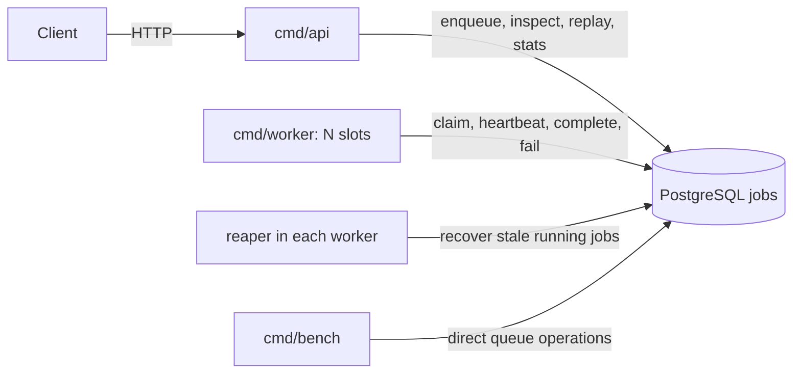
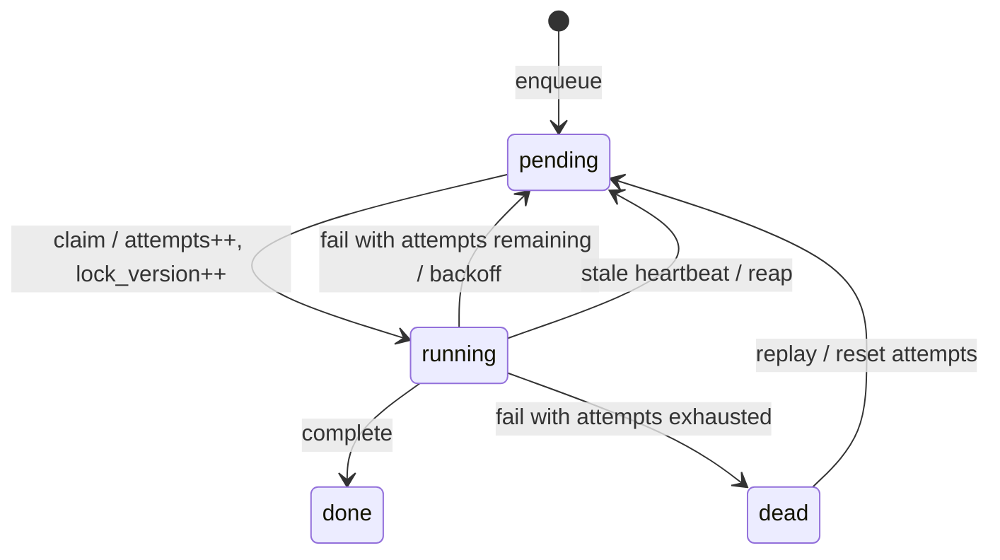

# JQS architecture

JQS uses PostgreSQL as its only shared coordination layer. An HTTP API inserts jobs, independent worker processes poll and execute them, and a reaper in each worker recovers stale jobs. There is no separate broker or scheduler service.

## Components



- `cmd/api/main.go` registers `/enqueue`, `/jobs/{id}`, `/stats`, `/metrics`, and `/replay` on the standard HTTP server, listening on `:8080`.
- `cmd/worker/main.go` creates one shared pgx pool per process, configurable worker slots, and one reaper goroutine. Each slot executes one job at a time and starts a heartbeat goroutine while working.
- `internal/job/job.go` implements enqueue, claim, heartbeat, completion, retry/dead-letter transitions, recovery, inspection, replay, and aggregates.
- `internal/db/db.go` reads `DATABASE_URL`, constructs a pgx pool, and pings PostgreSQL. Its fallback is localhost port **5432**; Compose publishes PostgreSQL 16 at **5433**, so set the environment variable explicitly.
- `cmd/bench/main.go` exercises queue operations directly with a concurrency sweep. It deletes the selected queue at the beginning of each round; it does not measure the simulated worker handler.

See [README.md](README.md) for runnable commands and configuration defaults. Schema creation is manual through [migrations/0001_init.sql](migrations/0001_init.sql).

## Job storage

The `jobs` table retains pending, running, completed, and dead jobs in one place.

| Column | Role |
| --- | --- |
| `id` | `BIGSERIAL` primary key. |
| `queue_name` | Logical routing key; default `default`. |
| `payload` | Required JSONB job data. |
| `status` | Text state, initially `pending`. No CHECK constraint currently restricts values. |
| `priority` | Integer priority, default zero; larger values are selected first. |
| `run_at` | Earliest eligible claim time; initially database `now()`. Also stores retry scheduling. |
| `attempts` | Number of claims, incremented on every claim. |
| `max_attempts` | Failure retry budget, default five; enforced by `Fail`, not `Claim` or `Reap`. |
| `locked_by` | Worker slot identifier, usually `process-id#slot`. |
| `locked_at` | Claim timestamp. |
| `last_heartbeat` | Liveness timestamp initialized on claim and refreshed during execution. |
| `lock_version` | Integer generation incremented on claim. Used to guard worker writes. |
| `last_error` | Most recent failure text. |
| `created_at` | Submission timestamp. |

Lock and heartbeat fields may remain populated on terminal rows. Completion does not clear them; retry and recovery clear `locked_by` and `locked_at` but leave the heartbeat. The Go `Job` projection omits `locked_at` and `last_heartbeat`; inspection does not expose every database column.

The partial claim index is:

```sql
CREATE INDEX idx_jobs_claimable ON jobs (queue_name, priority DESC, run_at)
WHERE status = 'pending';
```

It excludes historical terminal rows and supports queue filtering and priority/time ordering. Its size still grows with pending work. Large histories still affect table storage, vacuuming, and aggregate scans; there is no retention process.

## Claiming and execution

The claim operation combines selection and update into one SQL statement:

```sql
WITH next_job AS (
    SELECT id FROM jobs
    WHERE status = 'pending' AND run_at <= now() AND queue_name = $1
    ORDER BY priority DESC, run_at ASC
    FOR UPDATE SKIP LOCKED
    LIMIT 1
)
UPDATE jobs
SET status = 'running', locked_by = $2, locked_at = now(),
    last_heartbeat = now(), lock_version = lock_version + 1,
    attempts = attempts + 1
FROM next_job
WHERE jobs.id = next_job.id
RETURNING jobs.id;
```

The actual implementation returns the job projection needed by the worker. Row locks prevent concurrent claim statements from selecting the same available row; `SKIP LOCKED` lets contenders proceed to other rows. Locks last for the statement's transaction, not for the handler's execution. Persistent ownership is represented by status and generation after commit.

Priority applies among eligible, unlocked rows. Equal priority and `run_at` have no deterministic ID tiebreaker. Locked rows may be skipped, and sustained high-priority traffic can starve lower-priority work. Future jobs become eligible through polling; there is no recurring-job scheduler or `LISTEN/NOTIFY` implementation.

An empty claim or claim error causes the slot to wait `-poll` (default 500 ms). After a job finishes, the slot immediately attempts another claim. The current handler sleeps roughly 50–2,000 ms and fails randomly on about 20% of attempts; it does not interpret the payload.

## State transitions



`Fail` records an error and either moves the job to `dead` or schedules a retry. Retry delay uses the application's clock and full jitter:

```text
delay = random value in [0, min(5 × 2^(attempts - 1), 600)) seconds
run_at = application time + delay
```

Claim eligibility and heartbeat comparisons use the database clock. Clock skew between hosts and the database can therefore affect retry timing.

Replay updates the same dead row rather than inserting another job. It resets `attempts` to zero, clears `last_error`, `locked_by`, and `locked_at`, and sets `run_at` to database `now()`. Payload, priority, creation time, retry budget, generation, and heartbeat are preserved until later operations change them.

## Heartbeats, recovery, and correctness limits

Each executing job refreshes its heartbeat every 10 seconds by default. Every worker process scans every 15 seconds for running jobs whose heartbeat is older than 45 seconds. Recovery resets them to pending and clears the owner and claim timestamp. The reaper scans **all queues**, regardless of the worker's `-queue` flag. Multiple reapers can run because recovered rows no longer satisfy the running-state predicate.

Completion and heartbeat require matching `id`, `lock_version`, and `status = 'running'`. Failure requires matching ID and generation, but **does not check running status**. These operations do not inspect affected-row counts: an ignored stale write returns no error and can still be logged or counted as successful by the worker.

Crucially, **reaping does not increment `lock_version`**. Only a subsequent claim increments it. A stale completion is rejected while a reaped row is pending, and older generations are rejected after a new claim, but a stale `Fail` can still modify the pending row before that claim. The generation guard therefore has an ownership gap; it is not a complete lease or fencing protocol. Stronger recovery would invalidate the generation on reap, consistently require running ownership, and report rejected writes.

The retry limit is enforced only when a handler reports failure. Repeated crashes and reclaims can increase `attempts` beyond `max_attempts` without sending a job to `dead`.

Execution is at least once under recovery: an old handler can continue after its heartbeat is considered stale while another worker executes the recovered job. Database generation checks do not fence external side effects such as sending email or charging a payment. Real handlers need idempotency keys or transactional coordination appropriate to their destination.

## Shutdown

SIGINT and SIGTERM cancel a shared context and stop further polling. The main goroutine waits for worker slots, but the simulated handler uses `time.Sleep` and does not observe cancellation. Heartbeats stop on cancellation, and final completion/failure writes use the canceled context, so in-flight jobs may remain running until a reaper recovers them. The current implementation does not guarantee graceful draining and does not explicitly join the reaper or heartbeat goroutines. The API uses `http.ListenAndServe` without graceful shutdown handling.

## Observability and deployment boundaries

`/stats` counts all stored jobs by status, optionally filtered by queue. `/metrics` exposes the same status counts, an enqueue counter local to that API process (reset on restart), running-job counts by worker slot, and the number of slots currently holding jobs. The active-worker metric is not a count of all live worker processes, and a stale running row can appear active until recovery. Metrics queries are separate reads and are not a single consistent snapshot.

The local Compose setup supplies PostgreSQL 16, demonstration credentials, a healthcheck, and a named persistent volume. The API and workers run on the host. `docker compose down` retains the volume; removing the volume deletes queue data.

There is no authentication, authorization, TLS termination, request-size limit, configured HTTP timeouts, automated migration runner, or data retention. Payloads are written to worker logs. Database credentials, network exposure, logging policy, idempotent handlers, ownership hardening, and shutdown behavior need attention before production use.

PostgreSQL keeps the infrastructure small and makes queue state easy to inspect with SQL. Polling adds idle query load and pickup latency; status changes create database write and vacuum work. Capacity depends on the workload and deployment, so benchmark results should describe their environment rather than imply a fixed PostgreSQL throughput ceiling.
